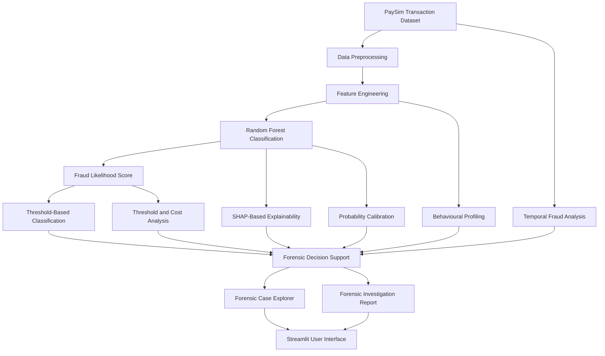

# Project Documentation

## Explainable Financial Fraud Detection and Forensic Intelligence Using Machine Learning

**Course:** Forensic Analytics  
**Institution:** Vellore Institute of Technology, Chennai  
**Subject Code:** CSE4074  
**Semester:** Fall 2026-27  
**Professor:** Dr. S. Johanan Joysingh  
**Team Members:** Veligaram Archana (23MIA1149) , Yamasani Lahari Sree (23MIA1129)

---

## 1. Abstract

Financial fraud detection is challenging because suspicious transactions may be rare and transaction behaviour can be complex. This project develops an interactive machine-learning workflow for estimating fraud likelihood and supporting forensic investigation. It uses the PaySim synthetic transaction dataset and a Random Forest classifier as the principal model in the application. Supporting analytical components include feature engineering, model comparison, behavioural profiling, probability calibration, threshold-cost analysis, temporal analysis, SHAP-based explanations, and forensic reporting. The intended contribution is the integration of established techniques into one interactive application. Since the dataset is synthetic, further evaluation on independent and representative datasets is necessary before drawing conclusions about real-world performance.

## 2. Introduction and Motivation

Automated fraud detection can help identify transactions that deserve further examination. However, a model score alone does not necessarily explain why a transaction was flagged or how an investigator should review it. This project combines a machine-learning prediction workflow with analytical tools to make results easier to explore. The application is intended to support analysis, not replace expert judgement or operational fraud controls.

## 3. Problem Statement

A classification-only workflow may provide a predicted class or score without enough context for forensic analysis. Investigators may also need to understand feature contributions, compare classifiers, inspect behavioural patterns, examine threshold trade-offs, and explore changes over time. This project integrates fraud-likelihood estimation with explanatory and investigative modules in one interface.

## 4. Objectives

1. Prepare and analyse the PaySim transaction dataset.
2. Engineer features from transaction amounts and account-balance changes.
3. Train and compare selected machine-learning classifiers.
4. Estimate fraud likelihood for transactions.
5. Examine behavioural risk and temporal fraud patterns.
6. Explore model explanations using SHAP-based analysis.
7. Analyse probability calibration and threshold-related trade-offs.
8. Present results through a Streamlit-based interface.

## 5. Existing Approaches

Rule-based systems flag transactions when predefined conditions are met. Machine-learning systems learn patterns from labelled historical examples. Ensemble methods combine models, while explainability methods such as SHAP can help describe how features contribute to predictions.

These methods have limitations. Rule-based systems may require frequent manual updates, and machine-learning models may be affected by class imbalance, data drift, leakage, and changes in transaction behaviour. Explanations also need careful interpretation and do not by themselves prove that a transaction is fraudulent.

## 6. Proposed Methodology

1. **Data loading:** Read PaySim data from the configured location.
2. **Preprocessing:** Inspect columns and prepare data for modelling.
3. **Feature engineering:** Derive transaction and balance-related features.
4. **Chronological splitting:** Separate data into training, validation, and test sets as implemented in the project.
5. **Model training:** Train selected classifiers and save required model artifacts where applicable.
6. **Evaluation:** Compare predictions using appropriate classification metrics.
7. **Analytical modules:** Run behavioural profiling, calibration, threshold-cost analysis, temporal exploration, and SHAP-based interpretation where implemented.
8. **Application integration:** Present available predictions and analysis in the Streamlit interface.
9. **Forensic review:** Use displayed scores and supporting evidence to prioritise transactions for further examination.

### 6.1 Feature Engineering

The documented feature set may include transaction step, amount, origin and destination balances, balance-change features, absolute balance discrepancies, amount-to-balance ratios, balance-depletion ratios, and encoded transaction types. The precise features should match the feature-generation code in the repository.

Account identifiers were excluded from the initial detection model in the documented design to reduce the risk of identifier memorisation. Describe additional behavioural profiling according to the actual implementation.

### 6.2 Model and Framework

Random Forest is the principal classifier integrated into the application. The project folder also contains comparison scripts and artifacts for other classifiers, potentially including XGBoost, LightGBM, CatBoost, Extra Trees, or Logistic Regression. Model comparison results should be tied to the correct data split and decision threshold.

### 6.3 Explainability

SHAP-based analysis examines feature contributions to model predictions. Global explanations summarise feature importance across multiple predictions; local explanations can help inspect an individual case. SHAP explanations describe model behaviour and should not be treated as proof of fraud or causation.

### 6.4 Behavioural and Temporal Analysis

Behavioural profiling summarises transaction patterns using the risk criteria implemented in the project. Temporal analysis examines changes in transaction volumes or fraud rates across transaction steps or time periods. Conclusions depend on the dataset and the definitions used.

### 6.5 Probability Calibration and Threshold Analysis

Probability calibration assesses whether predicted likelihoods correspond to observed event frequencies. Threshold analysis examines how changing the classification cutoff affects precision, recall, false positives, and false negatives. A selected threshold should reflect the project's evaluation strategy and should not be assumed optimal for every operational setting.

## 7. System Architecture

The following architecture diagram represents the project's workflow, including data preparation, Random Forest classification, analytical modules, and forensic decision-support outputs.

This diagram follows the architecture supplied for the project. Ensure that each module and connection shown is supported by the code currently included in the repository.

## 8. Module Descriptions

Include only modules that are present and working in the repository.

- **Application interface:** Provides the Streamlit interface for predictions and analysis.
- **Data preparation:** Loads data, engineers features, and prepares model inputs.
- **Model comparison:** Evaluates selected classifiers using implemented metrics.
- **Behavioural profiling:** Summarises transaction patterns and behavioural risk categories.
- **Probability calibration:** Examines the relationship between predicted scores and observed outcomes.
- **Threshold-cost analysis:** Studies trade-offs between missed fraud and false alerts at different thresholds.
- **Temporal analysis:** Explores fraud-related patterns across transaction steps or time periods.
- **SHAP analysis:** Summarises feature contributions to model predictions.
- **Forensic evidence and reporting:** Organises selected transaction details and analytical outputs for review, where implemented.

## 9. Dataset Description

The project uses PaySim, a synthetic financial transaction dataset. The original dataset used in this project contains approximately 6,362,620 rows and 11 columns, including transaction step, transaction type, amount, origin and destination account identifiers, account balances, and fraud labels.

Fraud is a small minority class, so evaluation should include precision, recall, F1-score, and precision-recall analysis rather than relying on accuracy alone. The full dataset is not included by default in the repository. Follow the permitted dataset source and the paths expected by the code.

## 10. Evaluation Metrics

- **Accuracy:** Proportion of all evaluated transactions classified correctly.
- **Precision:** Proportion of transactions predicted as fraud that are labelled fraud.
- **Recall:** Proportion of labelled fraud transactions detected by the model.
- **F1-score:** Harmonic mean of precision and recall.
- **ROC-AUC:** Ranking performance across false-positive and true-positive rates.
- **PR-AUC:** Summarises precision-recall performance and is particularly informative when the positive class is rare.

Report the evaluation split, selected threshold, confusion matrix, and class distribution alongside metrics. Do not compare values from different splits as if they were directly equivalent.

## 11. Results and Discussion

Insert the final, verified results from the actual application and scripts. Recommended material includes the model comparison table, confusion matrix, behavioural risk distribution, probability calibration plot, threshold analysis, temporal fraud-rate plot, SHAP feature-importance plot, and a screenshot of the forensic case investigation interface.

Explain what each figure shows and state which dataset split it represents. Because the results are based on synthetic data and some metrics may be unusually high, check for feature leakage and validate on independent data before claiming generalisation.

## 12. Novelty and Contribution

The project does not claim that Random Forest, SHAP, or behavioural analysis is individually new. Its intended contribution is the integration of fraud prediction, model interpretation, behavioural profiling, probability calibration, threshold-cost analysis, temporal exploration, and forensic investigation support in one interactive workflow.

Demonstrate this contribution through the implemented modules and how they work together rather than by claiming unsupported performance superiority.

## 13. Limitations

- PaySim is synthetic and cannot represent every real transaction or fraud scenario.
- Model performance may change on independent datasets and under temporal drift.
- Very high evaluation scores require checks for feature leakage and split-specific effects.
- SHAP explanations describe model behaviour but do not establish causation or prove fraud.
- The system is an academic decision-support prototype, not a substitute for operational controls or expert investigation.

## 14. Future Scope

Potential future work includes evaluation on additional permitted datasets, testing under realistic temporal drift, monitoring calibration, improving case management, and obtaining domain-expert feedback. Clearly distinguish future work from features already implemented.

## 15. References
[1] D. Vijayanand and G. S. Smrithy, “Explainable AI-enhanced ensemble learning for financial fraud detection in mobile money transactions,” Intelligent Decision Technologies, vol. 19, no. 1, pp. 52–67, 2025. DOI: https://doi.org/10.1177/18724981241289751.
[2] J. Jin and Y. Zhang, “The analysis of fraud detection in financial market under machine learning,” Scientific Reports, vol. 15, no. 1, Art. no. 29959, Aug. 2025, doi: 10.1038/s41598-025-15783-2.
[3] N. Zuberi, M. M. Rahman, S. U. Rashid, M. N. Ahsan, M. S. Rahman, and M. H. O. R. Mollah, “A robust machine learning framework for detecting temporal drift in financial fraud prevention,” Scientific Reports, vol. 16, Art. no. 27776, 2026. DOI: 10.1038/s41598-026-58285-5.
[4] T. Albalawi and S. Dardouri, “Enhancing credit card fraud detection using traditional and deep learning models with class imbalance mitigation,” Frontiers in Artificial Intelligence, vol. 8, Art. no. 1643292, 2025. DOI: 10.3389/frai.2025.1643292.
[5] F. Thiong’o, L. Nderu, R. W. Mwangi, et al., “A drift adaptive framework for detecting and tracking evolving anomalies in financial transaction streams,” Scientific Reports, 2026. DOI: 10.1038/s41598-026-70457-x.

## 16. Team Details

### Team Members
1. **Veligaram Archana** – 23MIA1149
2. **Yamasani Lahari Sree** – 23MIA1129

### Project Guide
**Dr. S. Johanan Joysingh**
